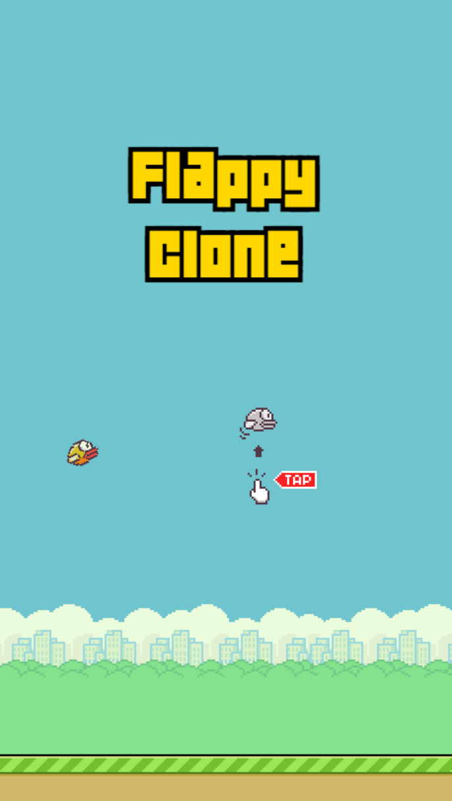
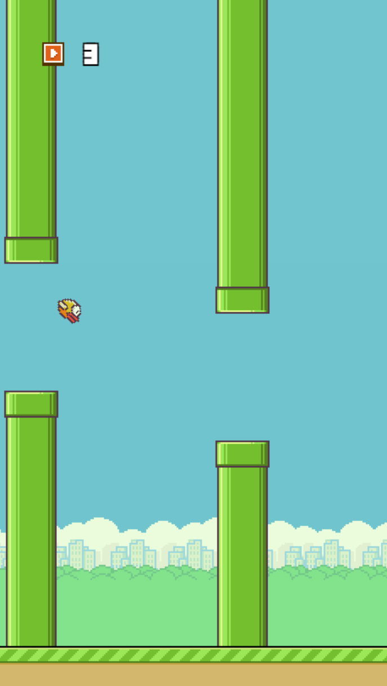
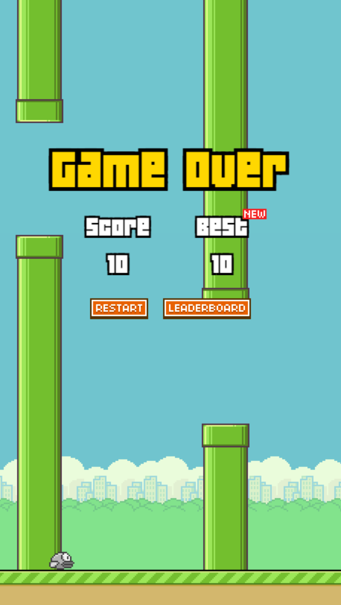
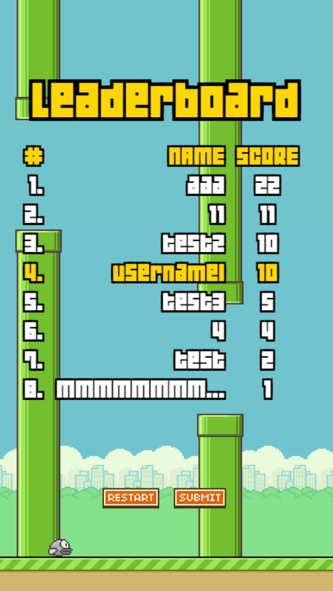

# [`trolleyman.org`](https://trolleyman.org)
[](https://app.netlify.com/projects/trolleyman/deploys)

React Router v7 (formerly Remix) implementation of my website!

Also hosting on Netlify at [trolleyman.netlify.app](https://trolleyman.netlify.app).

## TODO
- Fix links (prod links don't work)

## Getting Started

### Installation
```bash
npm install
```

### Development
```bash
npm run dev
```

## Building for Production

Create a production build:

```bash
npm run build
```

## Deployment

### Docker Deployment
```bash
docker build -t my-app .

# Run the container
docker run -p 3000:3000 my-app
```

### DIY Deployment
`npm run build` output:

```
├── package.json
├── package-lock.json (or pnpm-lock.yaml, or bun.lockb)
├── build/
│   ├── client/    # Static assets
│   └── server/    # Server-side code
```

## Main URLs
### `/`: [trolleyman.org](https://trolleyman.org)
Small personal website, displaying some projects that I've worked on over the years.

### `/flappy`: FlappyClone
A fully responsive HTML5 canvas-based Flappy Bird clone with a global leaderboard.

   

#### Controls
Space or click/tap on the screen to flap.

### `/linc`: LINC
A small project completed for Millenium Point.
